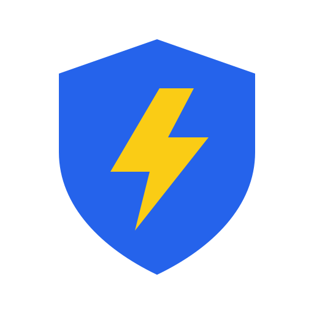

  

<h1 align="center">UAPowerGuardKit</h1>

Power monitoring, outage schedules, and alerts

<a href="https://github.com/uapowerguardkit/.github/blob/main/profile/README.md">Українська</a> · English

UAPowerGuardKit is an independent collection of apps, firmware, and services for power monitoring in Ukraine. It brings together mobile devices, ESP boards, scheduled outage data, and Telegram notifications.

## Products

| Component | Purpose |
| --- | --- |
| [iOS app](https://github.com/Baskerville42/SvitloBotIOS) | SvitloBot: iPhone/iPad charging status, server signals, or a separate Telegram fallback. |
| [ESP firmware](https://github.com/Baskerville42/svitloboard) | SvitloBoard: ESP8266/ESP32 availability signals to SvitloBot or a custom URL. |
| [DTEK parser](https://github.com/Baskerville42/outage-data-ua) | outage-data-ua: outage schedules from the provider’s web pages in JSON and PNG. |
| [Telegram bot](https://github.com/Baskerville42/outage_ua_bot) | GraphenkoBot: updates and pins schedule PNG images in channels and chats. |

**Monitoring and schedules are different sources.** The iOS app uses charging as an indirect signal of power availability; ESP reports device availability, which also depends on Wi-Fi and internet access. The parser and GraphenkoBot use schedules published by the provider — they do not measure whether power is present.

## Get started

- **iOS:** [app guide](https://baskerville42.github.io/SvitloBotIOS/) — monitoring and Telegram fallback setup.
- **ESP:** [flashing](https://github.com/Baskerville42/svitloboard#прошивання) → [device setup](https://github.com/Baskerville42/svitloboard#як-це-працює).
- **DTEK schedules:** [data format](https://github.com/Baskerville42/outage-data-ua#формат-даних) and [ready-made PNG images](https://github.com/Baskerville42/outage-data-ua/tree/main/images).
- **Telegram:** [GraphenkoBot quick start](https://github.com/Baskerville42/outage_ua_bot#швидкий-старт) — connect a channel or chat and select a schedule image.

## Feedback

Report bugs and suggest improvements in the relevant product’s Issues: [iOS](https://github.com/Baskerville42/SvitloBotIOS/issues) · [ESP](https://github.com/Baskerville42/svitloboard/issues) · [DTEK parser](https://github.com/Baskerville42/outage-data-ua/issues) · [Telegram bot](https://github.com/Baskerville42/outage_ua_bot/issues).
