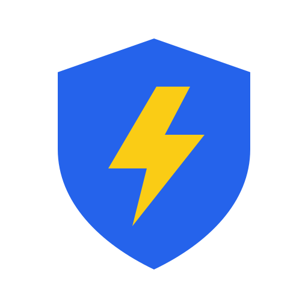

  

<h1 align="center">UAPowerGuardKit</h1>

Моніторинг живлення, графіки відключень і сповіщення

Українська · <a href="https://github.com/uapowerguardkit/.github/blob/main/profile/README.en.md">English</a>

UAPowerGuardKit — незалежний набір застосунків, прошивок та сервісів для моніторингу електроживлення в Україні. Об’єднуємо мобільні пристрої, ESP, дані про планові відключення та Telegram-сповіщення.

## Продукти

| Компонент | Призначення |
| --- | --- |
| [Застосунок iOS](https://github.com/Baskerville42/SvitloBotIOS) | СвітлоБот: стан заряджання iPhone/iPad, сигнали серверу або окремий Telegram-fallback. |
| [Прошивка ESP](https://github.com/Baskerville42/svitloboard) | SvitloBoard: сигнали доступності ESP8266/ESP32 до СвітлоБота або власної URL-адреси. |
| [Парсер DTEK](https://github.com/Baskerville42/outage-data-ua) | outage-data-ua: графіки відключень із вебсторінок постачальника у JSON та PNG. |
| [Telegram-бот](https://github.com/Baskerville42/outage_ua_bot) | GraphenkoBot: оновлення й закріплення PNG графіків у каналах і чатах. |

**Моніторинг і графіки — різні джерела.** iOS використовує заряджання як непрямий сигнал про живлення; ESP повідомляє про доступність пристрою, на яку також впливають Wi-Fi та інтернет. Парсер і GraphenkoBot працюють з опублікованими графіками постачальника — вони не вимірюють наявність електроенергії.

## Як почати

- **iOS:** [інструкція застосунку](https://baskerville42.github.io/SvitloBotIOS/) — налаштування моніторингу та Telegram-fallback.
- **ESP:** [прошивання](https://github.com/Baskerville42/svitloboard#прошивання) → [налаштування пристрою](https://github.com/Baskerville42/svitloboard#як-це-працює).
- **Графіки DTEK:** [формат даних](https://github.com/Baskerville42/outage-data-ua#формат-даних) і [готові PNG](https://github.com/Baskerville42/outage-data-ua/tree/main/images).
- **Telegram:** [швидкий старт GraphenkoBot](https://github.com/Baskerville42/outage_ua_bot#швидкий-старт) — підключення каналу або чату й вибір зображення графіка.

## Зворотний зв’язок

Помилки та пропозиції залишайте в Issues відповідного продукту: [iOS](https://github.com/Baskerville42/SvitloBotIOS/issues) · [ESP](https://github.com/Baskerville42/svitloboard/issues) · [парсер DTEK](https://github.com/Baskerville42/outage-data-ua/issues) · [Telegram-бот](https://github.com/Baskerville42/outage_ua_bot/issues).
